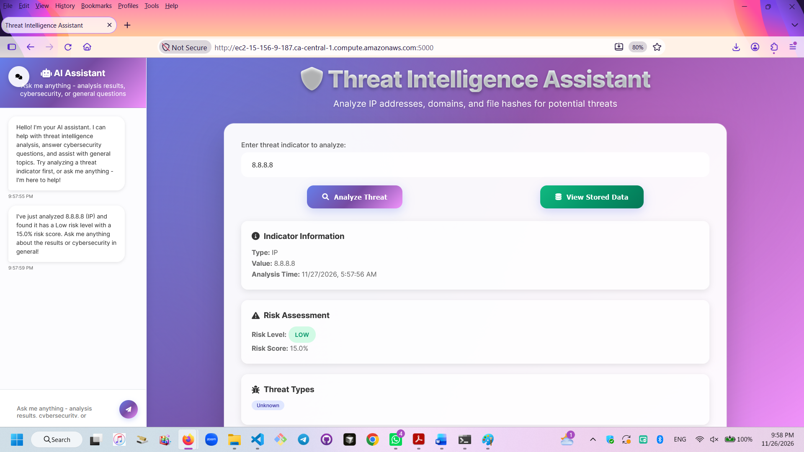
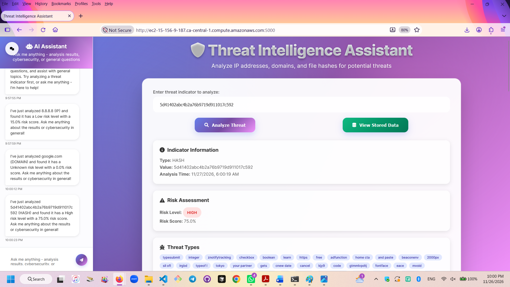
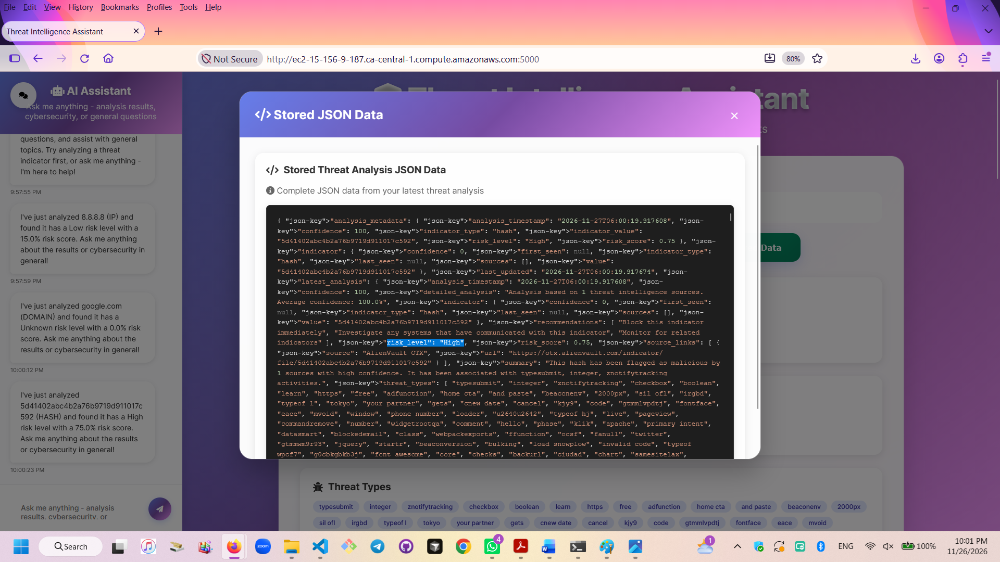
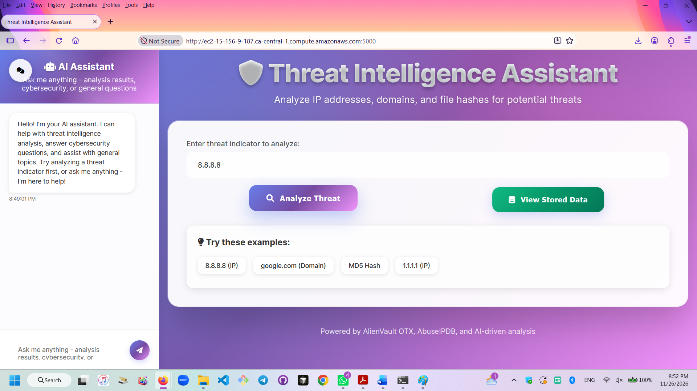
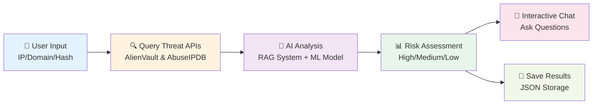

# 🛡️ Threat Intelligence Assistant

A modern, AI-powered threat analysis platform that instantly evaluates IP addresses, domains, and file hashes for potential security risks. Features an intelligent chatbot assistant and beautiful, responsive web interface.

## ✨ Key Features

- **🔍 Multi-Source Analysis**: AlienVault OTX, AbuseIPDB threat intelligence
- **🤖 AI-Powered Chatbot**: Interactive assistant for analysis results
- **🎨 Modern UI**: Glass morphism design with smooth animations
- **📊 Smart Risk Assessment**: ML-enhanced scoring with clear recommendations
- **🌐 Web Interface**: Beautiful, responsive design at `http://localhost:5000`
- **🔗 API Access**: RESTful endpoints for integration
- **🧠 RAG System**: Retrieval-Augmented Generation for intelligent summaries
- **💾 Data Storage**: Automatic storage of threat analysis results
- **📋 JSON Viewer**: Beautiful modal to view stored analysis data with syntax highlighting

## ☁️ AWS EC2 Deployment & Application Demo

The Threat Intelligence Assistant was deployed on an **AWS EC2 Ubuntu instance** using **Docker Compose** and **Gunicorn**. The screenshots below document the running web application, threat-analysis results, and JSON evidence. The EC2 instance is stopped when not needed to reduce compute costs, so the live URL may be unavailable or change when the instance is restarted.

### Application interface


*The application home page supports IP addresses, domains, and file hashes.*

### Threat analysis results

| IP reputation assessment | High-risk file hash |
| --- | --- |
|  |  |
| A successful lookup of `8.8.8.8` returned **LOW (15%)** after the risk-classification regression fix. | An example MD5 hash returned **HIGH (75%)** based on the threat intelligence results at the time of analysis. |

### Stored analysis data



*The stored JSON viewer exposes the structured risk assessment, analysis metadata, and source references.*

<details>
<summary>Additional screenshot: indicator entry</summary>



</details>

### Deployment verification

- Built the Flask application into a Docker image and ran it on EC2 with Docker Compose and Gunicorn.
- Confirmed the container reported **healthy** and the `/health` endpoint responded successfully.
- Added and ran **11 regression tests** for LOW, MEDIUM, HIGH, UNKNOWN, missing API data, and malformed responses; all passed locally and on EC2.
- Merged the risk-assessment fix into `main` via [pull request #1](https://github.com/FatemehKaram/rag-threat-intel-assistant-app/pull/1).
- Retained the previous Docker image as a rollback option before deployment.

**Deployment note:** Screenshots document testing on the EC2 instance; they are not a continuously hosted demonstration. The test endpoint used HTTP, not HTTPS. LOW and HIGH describe the results returned by the threat-intelligence feeds at the time of testing, not guarantees of safety or maliciousness.

## 🛠️ Tech Stack

**Backend:**
- Python 3.9+
- Flask (Web Framework)
- OpenAI API (GPT-3.5-turbo for AI features)
- scikit-learn (Machine Learning)
- NumPy, Joblib (ML Model Management)

**Frontend:**
- HTML5, CSS3 (Glass morphism design)
- JavaScript (Interactive UI)

**APIs & Integrations:**
- AlienVault OTX API
- AbuseIPDB API
- OpenAI API

**DevOps & Deployment:**
- Docker & Docker Compose
- Gunicorn (Production WSGI server)
- Environment-based configuration

**Data & ML:**
- RAG (Retrieval-Augmented Generation) system
- Random Forest Classifier for risk assessment
- TF-IDF Vectorization
- JSON data storage

## 💼 Skills Demonstrated

- **Full-Stack Development**: Flask backend with modern frontend
- **AI/ML Integration**: RAG system, ML-based risk assessment, LLM integration
- **API Integration**: Multiple third-party threat intelligence APIs
- **System Design**: Modular architecture with separation of concerns
- **DevOps**: Docker containerization, production deployment
- **Data Processing**: Threat intelligence synthesis and analysis
- **Security**: Secure API key management, input validation
- **Testing**: Automated testing suite

## 🏗️ Architecture Highlights

- **RAG System**: Retrieval-Augmented Generation for intelligent threat synthesis
- **ML Risk Assessment**: Machine learning model for automated risk scoring
- **Modular Design**: Separate classes for API handling, storage, analysis, and RAG
- **Fallback Mechanisms**: Graceful degradation when APIs are unavailable
- **Data Persistence**: JSON-based storage for threat analysis history

## 📊 How It Works



## 📋 Prerequisites

Before setting up the application, ensure you have:

- **Python 3.9+** installed on your system
- **pip** (Python package installer)
- **Git** (for cloning the repository)
- **API Keys** (optional but recommended):
  - [AlienVault OTX API Key](https://otx.alienvault.com/api) (free)
  - [AbuseIPDB API Key](https://www.abuseipdb.com/api) (free tier available)
  - [OpenAI API Key](https://platform.openai.com/api-keys) (for AI features)

## 🚀 Installation & Setup

### Method 1: Automated Setup (Recommended)

1. **Clone the repository**
   ```bash
   git clone <repository-url>
   cd rag-threat-intel-assistant-app
   ```

2. **Run the automated setup script**
   ```bash
   python setup.py
   ```
   This will:
   - Create necessary directories
   - Install Python dependencies
   - Create a `.env` configuration file
   - Set up the project structure

3. **Configure API keys** (Edit the `.env` file created by setup)
   ```env
   # Threat Intelligence APIs
   ALIENVAULT_API_KEY=your_otx_key_here
   ABUSEIPDB_API_KEY=your_abuseipdb_key_here
   OPENAI_API_KEY=your_openai_key_here  # Optional for AI summaries

   # Flask Configuration
   SECRET_KEY=your-secret-key-here
   FLASK_ENV=development
   FLASK_DEBUG=True
   ```

4. **Start the application**
   ```bash
   python app.py
   ```

### Method 2: Manual Setup

1. **Clone the repository**
   ```bash
   git clone <repository-url>
   cd rag-threat-intel-assistant-app
   ```

2. **Create a virtual environment** (recommended)
   ```bash
   python -m venv venv
   
   # On Windows:
   venv\Scripts\activate
   
   # On macOS/Linux:
   source venv/bin/activate
   ```

3. **Install dependencies**
   ```bash
   pip install -r requirements.txt
   ```

4. **Create necessary directories**
   ```bash
   mkdir -p templates static models logs
   ```

5. **Create environment configuration file**
   Create a `.env` file in the project root:
   ```env
   # Threat Intelligence APIs
   ALIENVAULT_API_KEY=your_otx_key_here
   ABUSEIPDB_API_KEY=your_abuseipdb_key_here
   OPENAI_API_KEY=your_openai_key_here  # Optional for AI summaries

   # Flask Configuration
   SECRET_KEY=your-secret-key-here
   FLASK_ENV=development
   FLASK_DEBUG=True

   # Application Settings
   MAX_RESULTS=50
   CACHE_DURATION=3600
   ```

6. **Run the application**
   ```bash
   python app.py
   ```

### Method 3: Using the Startup Script

1. **Follow steps 1-3 from Method 2**

2. **Use the startup script** (includes dependency checks)
   ```bash
   python run.py
   ```

## 🐳 Docker Deployment

### Using Docker Compose (Recommended)

1. **Create environment file**
   ```bash
   cp .env.example .env  # Edit with your API keys
   ```

2. **Build and run with Docker Compose**
   ```bash
   docker-compose up --build
   ```

### Using Docker directly

1. **Build the Docker image**
   ```bash
   docker build -t threat-intel-assistant .
   ```

2. **Run the container**
   ```bash
   docker run -p 5000:5000 \
     -e ALIENVAULT_API_KEY=your_key \
     -e ABUSEIPDB_API_KEY=your_key \
     -e OPENAI_API_KEY=your_key \
     -e SECRET_KEY=your_secret \
     threat-intel-assistant
   ```

## 🔑 API Key Setup

### AlienVault OTX (Free)
1. Visit [AlienVault OTX](https://otx.alienvault.com/api)
2. Sign up for a free account
3. Navigate to your profile settings
4. Generate an API key
5. Add to your `.env` file as `ALIENVAULT_API_KEY`

### AbuseIPDB (Free tier available)
1. Visit [AbuseIPDB](https://www.abuseipdb.com/api)
2. Create a free account
3. Go to API section in your dashboard
4. Generate an API key
5. Add to your `.env` file as `ABUSEIPDB_API_KEY`

### OpenAI (Optional - for AI features)
1. Visit [OpenAI Platform](https://platform.openai.com/api-keys)
2. Create an account and add billing information
3. Generate an API key
4. Add to your `.env` file as `OPENAI_API_KEY`

**Note**: The application works without API keys but with reduced functionality.

## 🌐 Access the Application

Once running, access the application at:
- **Web Interface**: `http://localhost:5000`
- **Analysis API**: `POST http://localhost:5000/analyze`
- **Chat API**: `POST http://localhost:5000/chat`
- **Stored Data API**: `GET http://localhost:5000/stored-data`
- **Health Check**: `GET http://localhost:5000/health`

## 🎯 Detailed Process

### Threat Analysis
1. **Input**: Enter IP address, domain, or file hash
2. **Intelligence Gathering**: Queries multiple threat intelligence sources
3. **AI Processing**: Uses RAG system for intelligent analysis
4. **Risk Assessment**: Generates risk score and recommendations
5. **Data Storage**: Automatically saves analysis results to JSON file
6. **Interactive Chat**: Ask questions about results via AI chatbot

### Data Storage & Viewing
- **Automatic Storage**: Every analysis is saved to `threat_data/latest_threat_analysis.json`
- **JSON Viewer**: Click "View Stored Data" to see complete analysis data
- **Syntax Highlighting**: Beautiful dark theme with color-coded JSON
- **Scrollable Interface**: Handle large datasets with ease
- **Modal Display**: Clean, focused view of stored threat intelligence data

### Risk Scoring
- **🔴 High Risk**: AbuseIPDB confidence ≥ 70% OR OTX pulse count ≥ 5
- **🟡 Medium Risk**: AbuseIPDB confidence ≥ 30% OR OTX pulse count ≥ 1  
- **🟢 Low Risk**: Minimal or no threat indicators detected

### Supported Indicators
- **IP Addresses**: IPv4 addresses (e.g., `8.8.8.8`)
- **Domains**: Website domains (e.g., `example.com`)
- **File Hashes**: MD5, SHA1, SHA256 hashes

## 💡 Features

### 🤖 AI Chatbot Assistant
- Context-aware responses about analysis results
- Natural language queries about threats
- Real-time conversation with typing indicators
- Mobile-responsive design

### 🎨 Modern Interface
- Glass morphism design with backdrop blur
- Smooth animations and hover effects
- Responsive layout for all devices
- Beautiful gradient backgrounds

### 🔧 Technical Capabilities
- **RAG System**: Retrieval-Augmented Generation for intelligent summaries
- **Fallback Logic**: Works without API keys (reduced functionality)
- **ML Integration**: Machine learning risk assessment
- **Real-time Analysis**: Instant threat evaluation

## 🧪 Testing

Run the test suite:
```bash
python test_app.py
```

Tests cover:
- Health check endpoint
- Threat analysis functionality
- Input validation
- Error handling

## 🧪 Testing & QA Improvements

The application was manually tested using different types of valid, invalid, incomplete, and edge-case inputs to improve reliability, usability, and user experience.

### Testing Activities
- Input validation testing
- Domain and IP edge-case testing
- Error handling verification
- Risk classification validation
- User-focused usability testing

### Example Issues Identified and Resolved
- Invalid IP-like values were incorrectly classified as domains
- Unknown or unverifiable domains returned misleading LOW risk results
- Input validation logic was improved using stricter regular-expression-based validation
- Risk assessment logic was updated to distinguish between verified low-risk indicators and insufficient-data situations

### Documentation Created
- Test Plan
- Test Cases
- Bug Reports
- Test Summary

These improvements helped improve the reliability, clarity, and usability of the application.

## 📝 Usage Examples

### Web Interface
1. Open `http://localhost:5000`
2. Enter threat indicator in the input field
3. Click "Analyze Threat" or press Enter
4. Review results and chat with AI assistant
5. Click "View Stored Data" to see complete JSON analysis data

### API Usage
```bash
curl -X POST http://localhost:5000/analyze \
  -H "Content-Type: application/json" \
  -d '{"indicator": "8.8.8.8"}'
```

### Chat API
```bash
curl -X POST http://localhost:5000/chat \
  -H "Content-Type: application/json" \
  -d '{"message": "What is the risk level?"}'
```

### Stored Data API
```bash
curl -X GET http://localhost:5000/stored-data
```

## 🛠️ Development

### Running in Development Mode

1. **Set development environment**
   ```bash
   export FLASK_ENV=development
   export FLASK_DEBUG=True
   ```

2. **Run with auto-reload**
   ```bash
   python app.py
   ```

### Project Structure

```
rag-threat-intel-assistant-app/
├── app.py                 # Main Flask application
├── config.py             # Configuration settings
├── run.py                # Startup script with checks
├── setup.py              # Automated setup script
├── requirements.txt      # Python dependencies
├── Dockerfile           # Docker configuration
├── docker-compose.yml   # Docker Compose setup
├── templates/           # HTML templates
├── static/             # Static assets (CSS, JS)
├── models/             # ML models and vectorizers
├── logs/               # Application logs
├── threat_data/        # Threat intelligence data storage
│   └── latest_threat_analysis.json  # Stored analysis results
└── rag/                # RAG system components
```

## 🚀 Production Deployment

### Using Gunicorn

1. **Install Gunicorn**
   ```bash
   pip install gunicorn
   ```

2. **Run with Gunicorn**
   ```bash
   gunicorn --bind 0.0.0.0:5000 --workers 4 --timeout 120 app:app
   ```

### Environment Variables for Production

```env
FLASK_ENV=production
FLASK_DEBUG=False
SECRET_KEY=your-strong-secret-key-here
ALIENVAULT_API_KEY=your_production_key
ABUSEIPDB_API_KEY=your_production_key
OPENAI_API_KEY=your_production_key
```

### Using Docker in Production

1. **Build production image**
   ```bash
   docker build -t threat-intel-assistant:latest .
   ```

2. **Run with environment variables**
   ```bash
   docker run -d \
     --name threat-intel-app \
     -p 5000:5000 \
     -e FLASK_ENV=production \
     -e SECRET_KEY=your_secret \
     -e ALIENVAULT_API_KEY=your_key \
     -e ABUSEIPDB_API_KEY=your_key \
     -e OPENAI_API_KEY=your_key \
     --restart unless-stopped \
     threat-intel-assistant:latest
   ```

## 🔧 Troubleshooting

### Common Issues

#### 1. Import Errors
**Problem**: `ModuleNotFoundError` when running the application
**Solution**:
```bash
# Ensure you're in the correct directory
cd rag-threat-intel-assistant-app

# Install dependencies
pip install -r requirements.txt

# Or use the setup script
python setup.py
```

#### 2. API Key Issues
**Problem**: "API key not configured" messages
**Solution**:
- Check your `.env` file exists and contains the correct API keys
- Ensure no extra spaces or quotes around the API key values
- Verify the API keys are valid and active

#### 3. Port Already in Use
**Problem**: `Address already in use` error
**Solution**:
```bash
# Find and kill the process using port 5000
# On Windows:
netstat -ano | findstr :5000
taskkill /PID <PID_NUMBER> /F

# On macOS/Linux:
lsof -ti:5000 | xargs kill -9

# Or use a different port
export PORT=8000
python app.py
```

#### 4. Permission Errors (Linux/macOS)
**Problem**: Permission denied when creating directories
**Solution**:
```bash
# Fix permissions
chmod +x setup.py run.py
sudo chown -R $USER:$USER .
```

#### 5. Docker Build Issues
**Problem**: Docker build fails
**Solution**:
```bash
# Clean Docker cache
docker system prune -a

# Rebuild without cache
docker build --no-cache -t threat-intel-assistant .
```

#### 6. Stored Data Issues
**Problem**: "No stored analysis data found" message
**Solution**:
- Ensure you've run at least one threat analysis first
- Check that `threat_data/latest_threat_analysis.json` exists
- Verify file permissions allow reading the JSON file
- Try analyzing a new indicator to generate fresh data

### Debug Mode

Enable debug mode for detailed error messages:

```bash
export FLASK_DEBUG=True
python app.py
```

### Health Check

Test if the application is running correctly:

```bash
curl http://localhost:5000/health
```

Expected response:
```json
{
  "status": "healthy",
  "timestamp": "2024-01-01T12:00:00",
  "version": "1.0.0"
}
```

### Logs

Check application logs for errors:

```bash
# View logs in real-time
tail -f logs/app.log

# Or check Docker logs
docker logs threat-intel-app
```

## 📚 Additional Resources

### API Documentation

- **Analysis Endpoint**: `POST /analyze`
  ```bash
  curl -X POST http://localhost:5000/analyze \
    -H "Content-Type: application/json" \
    -d '{"indicator": "8.8.8.8"}'
  ```

- **Chat Endpoint**: `POST /chat`
  ```bash
  curl -X POST http://localhost:5000/chat \
    -H "Content-Type: application/json" \
    -d '{"message": "What is the risk level?"}'
  ```

- **Health Check**: `GET /health`

### Supported Indicators

- **IP Addresses**: IPv4 addresses (e.g., `8.8.8.8`, `192.168.1.1`)
- **Domains**: Website domains (e.g., `example.com`, `malicious-site.org`)
- **File Hashes**: MD5 (32 chars), SHA1 (40 chars), SHA256 (64 chars)

### Risk Assessment

- **🔴 High Risk**: AbuseIPDB confidence ≥ 70% OR OTX pulse count ≥ 5
- **🟡 Medium Risk**: AbuseIPDB confidence ≥ 30% OR OTX pulse count ≥ 1  
- **🟢 Low Risk**: Minimal or no threat indicators detected

## 🤝 Contributing

1. Fork the repository
2. Create a feature branch (`git checkout -b feature/amazing-feature`)
3. Commit your changes (`git commit -m 'Add amazing feature'`)
4. Push to the branch (`git push origin feature/amazing-feature`)
5. Open a Pull Request

## 📄 License

This project is licensed under the MIT License - see the LICENSE file for details.

## 🆘 Support

If you encounter any issues:

1. Check the [Troubleshooting](#-troubleshooting) section
2. Review the application logs
3. Open an issue on GitHub with:
   - Your operating system
   - Python version
   - Error messages
   - Steps to reproduce

---

**Note**: This application works without API keys but with reduced functionality. For full features, configure the API keys as described in the [API Key Setup](#-api-key-setup) section.
